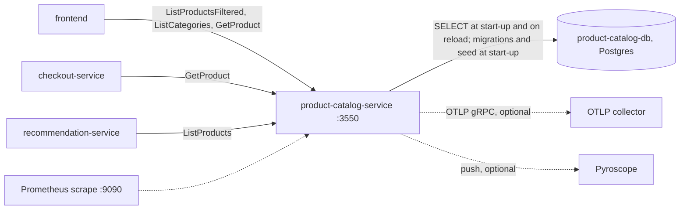
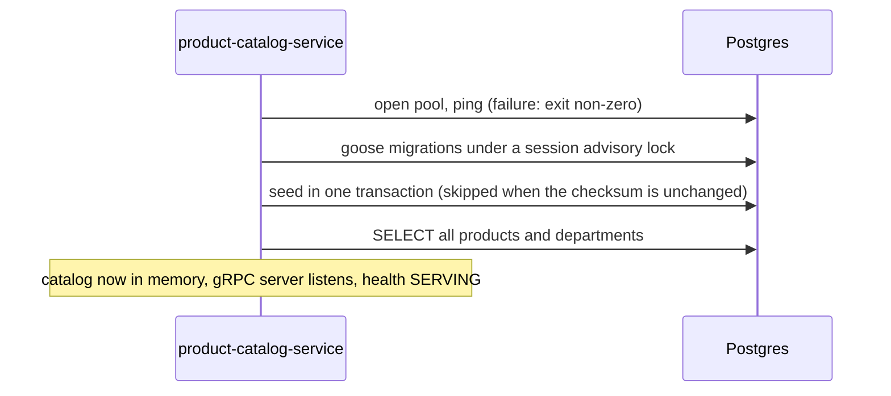

# Architecture

## Context

The service calls no other service. The callers are taken from the README ("Called by"); which RPC each caller uses was not re-verified in the callers' code for this page. Images of the products are not served here: the paths in the data point to `/static/img/products/...` of the `frontend`.

## Start-up

Migrations (`internal/catalog/migrations/`, embedded) and the seed (`data/seed/*.json`, embedded through the `data` package) are owned by this service ([ADR 1](adr/0001-service-owns-schema-and-seed.md)). Replicas that start together serialise on a Postgres advisory lock, so each migration and the seed run once.

## Reads

Every read RPC works on the in-memory copy ([ADR 2](adr/0002-in-memory-catalog-with-signal-reload.md)): `ListProductsFiltered` filters, sorts and pages in memory; `ListCategories` computes `product_count` from the cached products. Postgres is read again only when the cache is empty or after `SIGUSR1` has armed a reload.

## Components

| Where | Role |
|---|---|
| `cmd/server/main.go` | listen, health service, reflection, signal handling (SIGUSR1/2 reload flag, SIGTERM/SIGINT drain), optional `EXTRA_LATENCY` |
| `internal/catalog/loader.go` | pgx pool, loading products and departments, the in-memory cache, query timeouts |
| `internal/catalog/migrate.go`, `seed.go`, `migrations/` | goose migrations and the checksum-guarded seed |
| `internal/catalog/service.go`, `filter.go` | the RPCs, filter, sort and paging |
| `internal/catalog/recovery.go`, `cmd/server/rpclog.go` | panic recovery interceptor, request logging |
| `data/` | embedded seed (`products.json`, `categories.json`), `ATTRIBUTION.md`, `SOURCES.md` |
| `internal/healthcheck/`, `internal/obs/` | the `healthcheck` subcommand; telemetry, logs, metrics (same package in every Go service) |

## Contracts

The proto package is `hipstershop` (legacy name, [ADR 3](adr/0003-legacy-proto-package-hipstershop.md)); changes are additive only.
